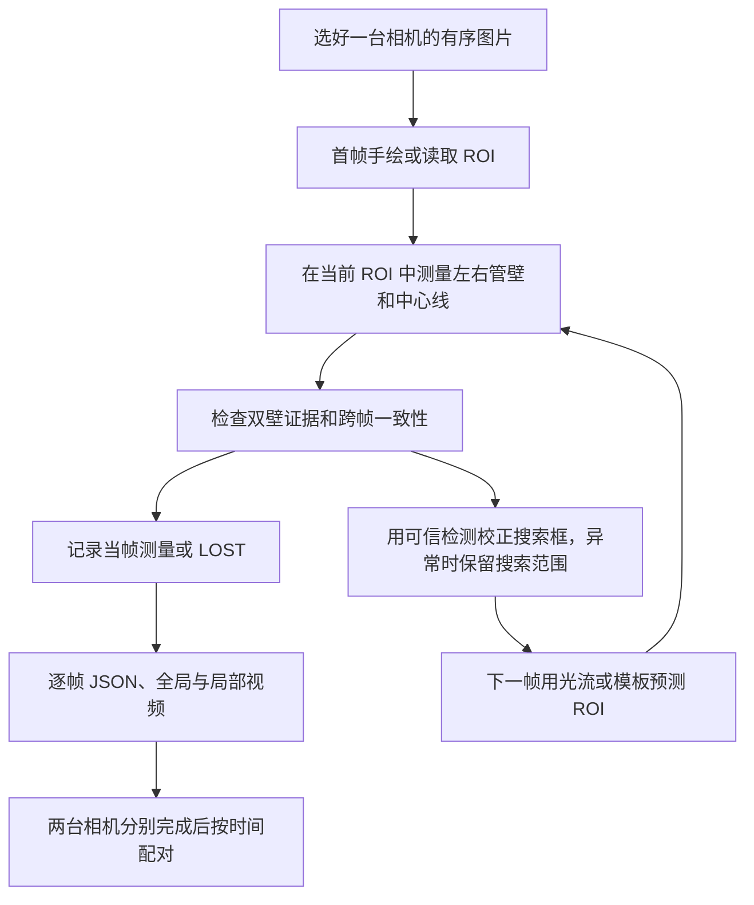

# StereoTracking · 双目图像序列中的管壁提取与跟踪

在每台相机的首帧圈出想观察的管道，程序逐帧跟随各个选区（ROI），在原始图像坐标中测量管道两侧边缘和中心线。全局视频用来看有没有跟错管，局部放大视频用来看两侧线是否贴壁。需要做双目分析时，再按采集时间将左右两路测量放到同一行。

**本阶段交付的是二维图像测量和左右帧的时间配对。** 左右相机分别框选，`R1` 等编号只在各自的选区文件内有效。跨视图比较同一根管道前，需要确认两个编号对应的实物。相机标定、三维直线重建和位姿求解属于后续步骤。

## 1. 第一次启动

以下命令在 Windows PowerShell 中执行。现场使用 Python 3.12.7、OpenCV 和 NumPy，计算在 CPU 上完成。先准备同一机位、按时间连续的至少两张图片，左右相机分开放。仓库提供源代码和测试，现场 BMP、手绘选区及录像保存在采集电脑上。

```powershell
git clone https://github.com/urheipi/stereotracking.git
cd stereotracking
py -3.12 -m venv .venv
.\.venv\Scripts\python.exe -m pip install -r requirements.txt
```

已克隆仓库的电脑可在项目根目录执行 `git pull --ff-only origin main` 更新主分支。本阶段最终版的固定标签为 `tracking-final-2026-11-27`。

在项目根目录运行以下命令，把路径换成自己的图片目录。这里先处理右相机。

```powershell
.\run_testbmp_live.cmd -Camera right -ImageDir "D:\采集数据\右相机"
```

1. 在首帧沿一段管道的外围依次左击至少三个点。框内应包含两侧管壁及少量外侧背景，长边尽量沿着管道。按 **N** 完成一根，再画下一根。**U** 撤销当前选区的上一个点。
2. 按 **Enter** 开始跟踪。在预览窗口滚轮缩放，右键拖动平移，**R** 恢复全图。**P** 暂停，**N** 单步，**C** 连续播放，**Q** 提前结束并保存已处理的部分。
3. 看青色的两侧管壁和黄色的中心线。红底 **LOST** 表示这根管道在当前帧缺少可信测量，程序继续在后续帧搜索。

另一台相机用同一个命令，将 `-Camera` 改为 `left` 并更换目录。若已在项目根目录放好 `testbmp\` 测试图，可直接双击 `run_testbmp_live.cmd`。默认读取 `*.bmp`，按文件名开头的数字时间戳排序。PNG 序列加 `-Pattern "*.png"`，用文件名顺序的序列可加 `-SortBy name`。

### 复用选区，批量生成视频

在本机的现场目录中，`trackingbmp` 对应左相机，`trackingright` 对应右相机。首次框选完成后，在项目根目录执行：

```powershell
powershell.exe -NoProfile -ExecutionPolicy Bypass -File .\scripts\run_tracking.ps1 -ImageDir "F:\tracking_test\trackingbmp"
powershell.exe -NoProfile -ExecutionPolicy Bypass -File .\scripts\run_tracking.ps1 -ImageDir "F:\tracking_test\trackingright"
```

这两条命令都调用 `track_main_tube_sequence.py`。批处理在对应机位的历史运行里查找与**首帧路径相同**的已存选区。图片换盘后，显式传入 `-InitialRois "原运行目录\drawn_rois.json"` 即可复用同一画面的选区。换机位或取景后，回到交互命令重新画。其他名称的目录用 `-Camera left` 或 `-Camera right` 指明机位。

| 常用选项 | 用途 |
| --- | --- |
| `-MaxFrames 40` | 先处理前 40 帧，快速检查选区和贴壁效果。默认处理全部。 |
| `-Diagnostics` | 额外生成本地诊断包，含按 ROI 汇总的丢失时段、逐帧判定依据和最多 32 张局部样图。适合无法传整套原图的情况。 |
| `-NoVideo` | 只需数值结果时跳过两份视频的编码。 |
| `-TrackScale 0.5` | 在较低分辨率估计运动，管壁检测仍用原始分辨率。细线场景应核对效果；本次现场结果使用默认值 1。 |
| `-OutDir "D:\指定目录"` | 覆盖默认结果目录。正常使用时由程序按机位归档。 |

## 2. 程序怎样从一帧走到下一帧



这里有两种用途不同的“特征”。**管壁边缘**回答“这一帧的中心线在哪里”，**选区里的角点**回答“下一帧去哪里找这根管”。角点跟踪成功后，程序仍会在新位置重新量两侧管壁。这也是为什么某根管道的运动状态可以是 `ok`，而该帧的测量状态是 `lost`。

### 2.1 单帧提取：从两个边缘得到一条中心线

1. **将选区拉正。** `rectify_polygon()` 用多边形的最小外接旋转矩形确定长短轴，将灰度图重采样到局部坐标。纵向 `y` 沿管，横向 `x` 横跨管径，多边形掩膜限定有效像素。因此水平、竖直、倾斜的管道可以共用后续流程。
2. **在横截面上找候选边。** 高斯平滑后计算横向和纵向 Sobel 梯度。沿管延伸的边缘在横向灰度变化更强，获得更高权重。将有效行的响应按列平均并平滑，就得到一条横跨管径的一维曲线，曲线的峰是候选管壁。跨过管身的短细线通常只能影响部分行。
3. **把两条边作为一对选择。** `find_edge_pair()` 枚举候选峰对。默认两峰间距占拉正窗口宽度的 0.28–0.92；评分还考虑边缘强度、沿管连续性、同一截面两壁是否同时有合理亮度变化，以及近期确认的管宽。饱和天空下的外轮廓与窄反光边有各自的证据检查。靠近细栏杆时，可用随管宽缩放的横向闭运算辅助选峰，再用原图的亮度变化核对管壁。
4. **拟合两侧边界。** 在每个峰附近逐行取支持点，用加权直线拟合得到 `x(y) = a·y + b`。按残差剔除偏离点后重新拟合。左右斜率有分歧时，沿候选方向比较整段支持，让清楚的一侧约束另一侧。双壁拟合不足时可退回候选列采样，发布测量仍须通过可见性检查。
5. **求中点并映回原图。** 对有效管段取多个截面，默认最多 60 个。通常每行取 `x中心(y) = (x左(y) + x右(y)) / 2`，再通过长短轴映射回原图。比如一行的两壁在 41 和 121 像素，中心就在 81 像素。序列也支持有条件的前景修正，输出字段 `centerline_source` 可区分 `edge-midpoint` 与 `foreground-body`。双壁稳定时保留中点。实现见 [detect_main_tube.py](detect_main_tube.py)。

### 2.2 跨帧跟踪：预测位置，再用实测管壁校正

- **估计运动。** 在上一帧的多边形内用 Shi–Tomasi 选角点，再用金字塔 Lucas–Kanade 光流将点跟到下一帧，并反向跟回。往返误差过大的点会被剔除。RANSAC 从剩下的点估计平移、旋转和统一缩放，将同一个 ROI 的顶点传播到新帧。
- **处理运动估计失真。** 点都挤在管端时，局部位移足以估平移，外推整根管的旋转或缩放容易漂移，程序此时采用位移中位数。特征不足可回退到模板匹配。若只有少量内点却给出大位移或明显缩放，匹配范围会带上管道周围的纹理，以区分沿管方向看起来几乎相同的图块。
- **修正搜索框。** 默认 `detect-corrected` 模式在新帧测得双壁后，用带余量的边界框校正下次的起点。当前管宽、首次确认的长度和近期尺寸历史共同约束搜索范围。遇到曝光突变、异常收缩或跳变时，程序可以拒绝更新搜索框，避免随后把背景越跟越牢。
- **控制开销。** 角点检测使用选区裁剪和掩膜，光流只在包含允许位移和金字塔边界余量的范围内计算。每帧灰度图由各选区共用；单帧管壁采样用数组运算。`-NoVideo` 可以单独省下渲染和编码耗时。实现见 [track_main_tube_sequence.py](track_main_tube_sequence.py)。

### 2.3 为什么会显示 LOST

默认要求候选至少达到中等置信度，且至少 20% 的截面同时支持两壁。与上一有效候选比较时，管宽比须在 `2/3–1.5` 之间。扣除搜索框自身的运动后，中心线沿管壁法向的跳动默认最多为 7 个原图像素。证据中断后重新捕获通常需要连续两帧相符的候选。

**真实例子：右相机第 394 帧的 R7。** 光流的 `tracking.status` 是 `ok`，双壁支持率约为 0.86，但中心线横向位置与前帧不一致。最终 `status` 为 `lost`，`failure_reason` 为 `inconsistent lateral position`，`centerline` 为 `null`。下游读取测量时应先看最外层 ROI 的 `status`。

若只是管段变短，程序还会单独评估两壁实际共同可见的一段。双壁均有拟合、各自至少覆盖窗口三分之一、共同可见段内至少半数截面支持双壁、管宽与近期值相差不超过 10%，且候选框仍达到预测长度的 60% 时，可以保留较长的搜索框，同时输出较短的实测线段。

## 3. 怎样读输出

默认写入 `tracking_results/runs/left_camera/<运行时间>/` 或 `right_camera/<运行时间>/`。

| 文件 | 怎么用 |
| --- | --- |
| `drawn_rois.json` | 手绘时保存。记录首帧图像、`roi_idx` 和原图多边形顶点，供同一序列重跑。 |
| `tracking_review_*.mp4` | 全局画面。灰框及框内标签作显示平滑；青色双壁线、黄色中心线、红底 LOST 随当帧测量更新。 |
| `roi_review_*.mp4` | 同一帧的所有 ROI 分格放大。每格保留首帧的方向和放大倍率，跟随当前区域，适合核对哪一侧贴到了栏杆、反光或遮挡物。 |
| `sequence_centerlines_*.json` | 原图坐标下的二维测量。`frames[n-1]` 对应视频画面上标注的第 `n` 帧，`image` 指向原图，`centerlines` 中按 `roi_idx` 查找管道。 |
| `*_diagnostics.zip` | 开启诊断时生成。先读 `summary.json` 找时段，再用 `measurements.csv` 和 `samples/` 对照判定依据。 |

JSON 中的 `vertices` 是实际搜索框。`centerline.endpoints` 按 `[x1, y1, x2, y2]` 存储，像素原点在原图左上，`x` 向右、`y` 向下。`line_eq` 给出归一化二维直线 `Ax + By + C = 0`。历史字段 `plucker` 存储三个二维线段量 `[x1·y2 − y1·x2, x2 − x1, y2 − y1]`，三维直线重建需要另外使用相机几何。`wall_pair_coverage` 表示同一截面能同时支持两壁的比例，`tracking` 保存运动估计和框更新信息。默认回放为 10 fps，第 `n` 帧的播放时间为 `(n−1)/10` 秒；现场采集间隔应从原图时间戳读取。

## 4. 双目时间匹配

左右相机各自按原始帧序跟踪。离线配对使用**文件名里的采集时间**，两侧相差 **≤ 1,000 毫秒**视作同步，每张图最多使用一次。本次文件名有两种时间表示，例如 `63883096137007_2025-05-17 16-28-47_307.bmp`。用开头的毫秒整数筛选，再独立用后半段日期、时分秒和毫秒核对。此次所有候选均唯一，两种方法得到完全相同的配对。

| 左图 | 右图 | 唯一配对 | 无对应图的单机帧号（从 1 开始） |
| ---: | ---: | ---: | --- |
| 988 | 991 | 987 | 左 623；右 35、147、554、770 |

现场配对表为 `tracking_results/stereo_pairs_20250517.csv`。同一行的 `left_frame` 和 `right_frame` 分别查左右视频或 JSON。例如第 348 对用左第 348 帧和右第 350 帧，两图文件名后半段的时刻相差 199 ms。全表前缀时间差绝对值最大 75 ms，后半段时刻差最大 416 ms。配对成功表示满足此次采集的时间容差；同一根管道在哪些帧上有两路测量，还需分别检查两个 ROI 的状态。

<details>
<summary>复现配对表：从两份跟踪 JSON 生成 CSV，并打印所有落单的原图</summary>

在项目根目录的 PowerShell 运行下段示例。把 `left_json` 和 `right_json` 换成本次左右运行的文件，保留各自的帧序。示例只读取 JSON 中的文件名，适用于上面这种双时间戳命名。若两个时间字段结论冲突、一个窗口里有多个候选，或右图被重复使用，会指出需要人工核对的图。输出写到独立的 `stereo_pairs_rebuilt.csv`。

```powershell
@'
import csv
import json
from datetime import datetime
from pathlib import Path, PureWindowsPath

runs = Path("tracking_results/runs")
left_json = runs / "left_camera/20261127_140424_876/sequence_centerlines_20261127_140424.json"
right_json = runs / "right_camera/20261127_123923_274/sequence_centerlines_20261127_123923.json"
output = Path("tracking_results/stereo_pairs_rebuilt.csv")

def read_frames(path):
    frames = json.loads(path.read_bytes())["frames"]
    result = []
    for frame in frames:
        name = PureWindowsPath(frame["image"]).name
        prefix, clock = Path(name).stem.split("_", 1)
        result.append((int(prefix), datetime.strptime(clock, "%Y-%m-%d %H-%M-%S_%f"), name))
    return result

left, right = read_frames(left_json), read_frames(right_json)
rows, used_right = [], set()
for i, (ts, clock, name) in enumerate(left, 1):
    by_prefix = [j for j, r in enumerate(right) if abs(r[0] - ts) <= 1000]
    by_clock = [j for j, r in enumerate(right) if abs((r[1] - clock).total_seconds()) <= 1]
    if by_prefix != by_clock or len(by_prefix) > 1:
        raise ValueError(f"Review timestamps for {name}")
    if not by_prefix:
        print("Left only:", i, name)
        continue
    j = by_prefix[0]
    if j in used_right:
        raise ValueError(f"Right frame used twice: {right[j][2]}")
    used_right.add(j)
    rt, rc, rn = right[j]
    rows.append((len(rows) + 1, i, name, j + 1, rn, rt - ts, round((rc - clock).total_seconds() * 1000)))
for j, (_, _, name) in enumerate(right):
    if j not in used_right:
        print("Right only:", j + 1, name)
with output.open("w", newline="", encoding="utf-8-sig") as f:
    writer = csv.writer(f)
    writer.writerow(("pair_id", "left_frame", "left_file", "right_frame", "right_file",
                     "prefix_delta_ms_right_minus_left", "clock_delta_ms_right_minus_left"))
    writer.writerows(rows)
print(len(rows), "pairs:", output)
'@ | .\.venv\Scripts\python.exe -
```

</details>

## 5. 现场问题、修复依据与剩余误差

| 当时看到的现象 | 原因、改动和复核结果 |
| --- | --- |
| 左 R1 在天空与格栅交界处偏离边缘，R3 在约第 830 帧被管内斜线带偏 | 同一管壁在不同背景上可能改变明暗方向。以多种距离核对窄反光边，并用对侧管壁提供独立证据；沿整段比较拟合方向，降低少数强干扰行的影响。左 R1 第 895 帧的抽查截面偏差从约 21.8 降到 1.0 原图像素，左 R3 第 830 帧左壁上部从约 5.7 降到 2.0 像素。 |
| 右 R7 从第 239 帧起跟丢，搜索框跳到其他位置 | 横穿管道的细线上只剩少数角点，却给出约 125 像素位移。加入周边纹理复核后，991 帧里的丢失由 755 帧降至 1 帧。 |
| 右 R1 遇到横梁，明明还有一段管壁却报丢 | 整个框内的支持率会被遮挡段稀释。对确实变短的管段检查双壁共同支持范围，丢失由 56 帧降至 8 帧。第 89、330 帧可看到剩余可见段。 |
| 右 R10 末段的边线贴到栏杆，曝光变化时左 R6 等选区误收缩 | 栏杆和管壁间的窄亮缝会形成额外强边。使用管宽先验、窄暗条抑制及原图亮度复核，右 R10 的丢失由 43 帧降至 0 帧，抽查第 930、970、991 帧确认贴壁。曝光保护会保留合理搜索范围，等待双壁重新可见。 |
| 全局画面的框和标签跳动 | 可见长度逐帧变化，框端点与标签随之往返。对齐相邻多边形顶点，沿管方向平滑，横向滞后限制在当前框宽的 7% 内，标签锚定在框内。右 R1 第 301–400 帧的成片标签位移第 95 百分位从 24.2 降到 10.0 原图像素。两路的逐帧测量和局部视频均与平滑前一致。 |

**最终现场验收。** 两路各跟踪 10 根管道。右侧 9,910 次逐管测量中有 10 次 LOST（R1 八次、R7 一次、R9 一次）；左侧 9,880 次中有 49 次（R6 两次、R9 十二次、R10 三十五次）。右侧算法修复前共有 855 次，左侧上一版为 43 次。左 R10 在第 350 帧附近的曝光变化仍值得复查。丢失次数衡量的是程序是否发布测量，沿边定位误差只对可辨认的截面做过抽查。两台相机来自同一次采集，其他现场和镜头仍需独立验证。

## 6. 源码阅读与测试

| 阅读顺序 | 可以带着什么问题读 |
| --- | --- |
| [序列主流程](track_main_tube_sequence.py) | 从 `run_sequence()` 看一帧如何经过运动预测、单帧检测、可见性判断、框更新与输出。再读 `_estimate_roi_transform()`、`assess_visibility()` 和 `reject_invalid_updates()`。 |
| [单帧检测](detect_main_tube.py) | 从 `detect_roi()` 顺着 `rectify_polygon()`、`find_edge_pair()`、`_fit_boundary_lines()`、`_sample_boundaries()` 看一对管壁如何变成原图中心线。 |
| [录像](tracking_videos.py)、[交互预览](review_window.py)、[诊断](tracking_diagnostics.py) | 看原图坐标怎样投影到局部视频，缩放与步进怎样工作，丢失时保存哪些证据。全局显示框的平滑在单帧检测模块的 `_review_polygon()` 中，由序列渲染调用。 |
| [检测测试](test_detect_main_tube.py)、[序列测试](test_track_main_tube_sequence.py) | 用合成管道复现窄栏杆、反光、斜线、错误光流及遮挡后重捕获，适合调试时逐个运行。 |

在项目根目录验证安装和实现：

```powershell
.\.venv\Scripts\python.exe -m pip install -r requirements-dev.txt
.\.venv\Scripts\python.exe -m unittest -q
.\.venv\Scripts\python.exe -m ruff check .
```

本阶段提交前，在全新的 Python 3.12 虚拟环境中按依赖文件安装了 NumPy 2.4.6 和 OpenCV 4.13.0.92，80 项单元测试及 Ruff 检查通过。另用现场选区通过 PowerShell 启动脚本处理 3 张实图，读回了两份视频和逐帧 JSON；第 4 节示例生成的 CSV 与现场 987 对配对表逐字节一致。

需要回到具体帧排查时，交接记录列有本机原图、原始选区、历次运行及最终视频路径。克隆到另一台电脑后，先准备该机能访问的原图和选区，再按本文第 1 节运行。[现场交接记录](handoff.md) · [检测流程详解](docs/current_detection_workflow.md)
