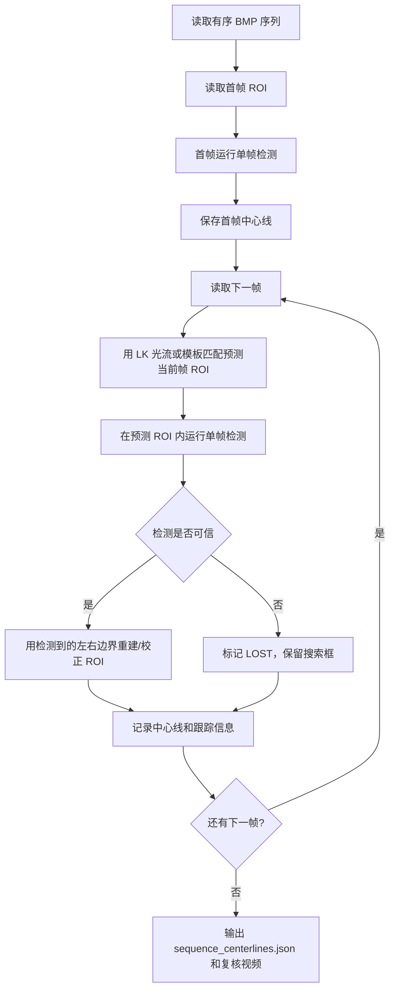

# 当前检测流程说明

本文说明当前项目里“主导管/主管中心线检测”是怎么做的，重点对应现在日常运行的序列脚本 `track_main_tube_sequence.py`，以及它调用的单帧检测器 `detect_main_tube.py`。

## 一句话概括

当前检测不是深度学习模型，也不是整图自动找所有目标。它是一个基于 ROI 的传统计算机视觉流程：

```text
首帧人工/JSON 给定 ROI
  -> 序列中用光流或模板匹配传播 ROI
  -> 在每个 ROI 内把局部图像拉正
  -> 用 Sobel 边缘证据找左右管壁
  -> 拟合左右边界线
  -> 取左右边界中点作为中心线
  -> 必要时用检测结果反向校正下一帧 ROI
```

也就是说，ROI 负责限定搜索范围，检测器只在 ROI 内找“最像主导管左右边界的一对长边”。

## 相关文件

- `detect_main_tube.py`：单帧、单个或多个 ROI 内的主导管边界检测。
- `track_main_tube_sequence.py`：图像序列处理，负责 ROI 跟踪、调用单帧检测、输出每帧中心线。
- `scripts/run_tracking.ps1`：当前常用运行入口。
- `tracking_results/drawn_rois.json`：左相机 testbmp 的历史首帧 ROI。现场选区保存在对应机位运行目录的 `drawn_rois.json`。
- `tracking_results/runs/<机位>_camera/<启动时间>/sequence_centerlines_*.json`：序列中心线结果。

## 整体流程



## 单帧检测怎么做

单帧检测入口是 `detect_main_tube.py` 里的 `detect_roi()`，每个 ROI 单独处理。

### 1. ROI 拉正

代码位置：

- `_basis_from_polygon()`
- `rectify_polygon()`

处理逻辑：

1. 对 ROI 多边形做 `cv2.minAreaRect()`，得到最小外接旋转矩形。
2. 取长边方向作为主轴 `long_axis`，取垂直方向作为宽度轴 `short_axis`。
3. 建立一个局部坐标系，把原图里倾斜的 ROI 重采样成一个矩形小图 `crop`。
4. 同时生成一个 ROI mask，保证后面只统计多边形内部的像素。

拉正后的图像里，管体通常变成“沿上下方向延伸、左右两侧是边界”的形态。这样后面的检测就从“任意方向找两条边”简化成“在宽度方向找左右两条长边”。

### 2. 构造边缘证据

代码位置：

- `_edge_evidence()`

处理逻辑：

1. 对拉正后的 ROI 小图做 Gaussian blur，降低噪声。
2. 用 Sobel 计算梯度：
   - `gx`：x 方向梯度。
   - `gy`：y 方向梯度。
3. 因为拉正后管壁主要是近似竖直边，所以重点保留 x 方向梯度强的响应。
4. 得到 `evidence`，可以理解为“某个像素像管壁边缘的程度”。
5. 在 mask 内沿 y 方向做列平均，得到一维宽度 profile。

这个 profile 的横轴是拉正 ROI 的宽度方向。如果左右管壁清楚，profile 上通常会出现两处明显峰值。

### 3. 寻找左右边界候选

代码位置：

- `_find_profile_peaks()`
- `find_edge_pair()`
- `_boundary_support()`

处理逻辑：

1. 在 profile 里找若干个局部峰值。
2. 两两组合成候选边界对：`left_x` 和 `right_x`。
3. 用几何和图像证据过滤、打分：
   - 两条边的距离必须在允许宽度范围内。
   - 默认 `min_width_frac = 0.28`，`max_width_frac = 0.92`。
   - 两条边附近要有足够多行存在强边缘响应。
   - 两条边的强度要相对背景 profile 足够突出。
   - 一侧管壁出现亮边时，检查亮边是否同时亮于内外两侧，并检查同一行另一壁在两个采样距离上是否都存在亮度台阶。这样管道经过暗色格栅时仍可选到双壁。
4. 选择得分最高的一对作为当前 ROI 的左右管壁。

如果找不到有效边界对，该 ROI 标记为：

```json
{
  "status": "failed",
  "confidence": "failed",
  "failure_reason": "no valid pair of long side edges"
}
```

### 4. 前景宽度修正

代码位置：

- `_foreground_column_profile()`
- `_foreground_span_around()`
- `_refine_pair_with_foreground_span()`

有些 ROI 里会出现内部强边缘，初始峰值可能落在管体内部，而不是外侧边界。为降低这种误选概率，检测器会额外统计较暗前景在每一列里的占比。

如果暗前景形成的整体宽度明显比初始边界更合理，程序会尝试把左右边界扩展到更外侧的峰值。

序列已有近期确认管宽时，扩展后的边界对还须与该宽度相符，以免把管壁外的格栅一起算入管宽。

### 5. 拟合左右边界线

代码位置：

- `_fit_one_boundary_line()`
- `_fit_boundary_lines()`

处理逻辑：

1. 在粗略的 `left_x`、`right_x` 附近逐行搜索局部最大边缘响应。
2. 收集每一行的边界采样点。
3. 对采样点做加权直线拟合：

```text
x = slope * y + intercept
```

4. 检查拟合质量：
   - 支撑行数要足够。
   - 斜率不能太大。
   - 残差不能太大。
   - 左右边界的斜率要接近。
5. 两壁方向接近时，按支持行数计算共同方向。如果两侧方向分歧明显，沿两个方向分别统计整段管壁的边缘响应，选两侧都有支持的方向。若一侧偏离原峰而另一侧点数多、残差小，则沿更可靠的方向重新定位偏离的一壁。贴着单侧管壁穿过的斜线因此较难带偏另一壁。

### 6. 生成中心线

代码位置：

- `_sample_boundaries()`
- `_foreground_centerline_offset()`
- `map_rectified_point()`

默认中心线取左右边界的中点：

```text
center_x = (left_x + right_x) / 2
```

如果 ROI 很高，并且暗前景轮廓足够可信，程序会尝试用前景体中心对中心线做小幅偏移修正。对应结果字段可能是：

```json
{
  "centerline_source": "foreground-body"
}
```

否则中心线来源是：

```json
{
  "centerline_source": "edge-midpoint"
}
```

最后，左右边界点和中心线点都会从拉正 ROI 坐标映射回原图坐标。

## 序列处理怎么做

序列处理入口是 `track_main_tube_sequence.py` 里的 `run_sequence()`。

### 1. 首帧

首帧 ROI 来自：

- `--initial-rois` 指定的 JSON，例如 `tracking_results/drawn_rois.json`。
- 或者 `--draw-rois` 交互式绘制。

首帧直接调用：

```python
results, _ = dmt.detect_all(prev_gray, roi_payload, config)
```

如果默认使用 `detect-corrected` 模式，首帧检测后也会根据检测到的左右边界重建一次 ROI。

### 2. 后续帧 ROI 预测

代码位置：

- `_detect_roi_features()`
- `_estimate_roi_transform()`
- `track_rois_between_frames()`

每一帧都会先从上一帧 ROI 预测当前帧 ROI：

1. 在上一帧 ROI mask 内用 `cv2.goodFeaturesToTrack()` 找角点。
2. 用 `cv2.calcOpticalFlowPyrLK()` 做 Lucas-Kanade 光流跟踪。
3. 再反向跟踪回来，用 forward-backward error 过滤不稳定点。
4. 用 `cv2.estimateAffinePartial2D(..., method=cv2.RANSAC)` 估计局部仿射变换。
5. 把变换作用到 ROI 顶点，得到当前帧预测 ROI。

如果角点不足、光流失败或有效跟踪点太少，会退到模板匹配：

```python
cv2.matchTemplate(..., cv2.TM_CCORR_NORMED)
```

如果预测 ROI 的中心跳变过大，或尺寸膨胀异常，会拒绝这个预测，保留上一帧 ROI。

### 3. 当前帧检测

拿到预测 ROI 后，再调用单帧检测：

```python
results, _ = dmt.detect_all(next_gray, predicted_roi_payload, config)
```

这一步和首帧一样，仍然是在 ROI 内检测左右边界和中心线。

### 4. 用检测结果校正 ROI

当前默认参数是：

```text
--roi-update-mode detect-corrected
```

这意味着当前帧检测成功后，会根据 `left_boundary`、`right_boundary`、`centerline` 反向生成新的 ROI，作为后续帧输入。

代码位置：

- `detect_main_tube.py` 的 `roi_vertices_from_detected_boundaries()`
- `track_main_tube_sequence.py` 的 `correct_roi_from_detection()`
- `track_main_tube_sequence.py` 的 `correct_rois_from_detections()`

校正时还会做保护：

- 检测置信度要达到 `--min-roi-update-confidence`，默认 `medium`。
- ROI 中心跳变不能超过 `--max-roi-jump`，默认 `200` 像素。
- 校正后的 ROI 短边不能低于 `--min-corrected-roi-short-span`，默认 `40` 像素。
- ROI 增长不能超过 `--max-corrected-roi-growth`，默认 `1.0`。

### 5. 曝光保护

代码位置：

- `measure_exposure_stats()`
- `exposure_suspect_info()`
- `guard_exposure_shrunken_rois()`

如果某些帧突然过曝，检测到的边界可能向内收缩，导致 ROI 变窄。当前默认打开：

```text
--exposure-guard shrink
```

当检测到均值亮度跳变、饱和像素比例上升，或者多个 ROI 同时异常缩窄时，程序会拒绝这类 ROI 收缩更新，保留预测 ROI 用于下一帧搜索。

曝光变亮时，检测器检查管壁外侧是否连续接近饱和、内侧是否仍有超过局部噪声的亮度差。两侧外轮廓都存在时，这项证据有助于避开管内阴影。边界拟合还会检查亮度变化方向，并根据相邻强边的位置限制搜索范围，减少平行栏杆对拟合的干扰。

在默认跟踪模式下，预测搜索框的宽度至少容纳最近确认管宽的 1.3 倍。长度下限根据首次确认的选区长度和管宽随时间的变化计算，避免长期累积的光流缩放把管壁裁出框外。搜索框负责限定候选位置，实际输出的线段仍由当帧边缘证据确定。

被拒绝时，跟踪信息里可能出现：

```json
{
  "update_status": "rejected-exposure-shrink"
}
```

### 6. 管壁可见性与丢失

`assess_visibility()` 逐帧检查当前测量。较弱管壁的边缘强度和连续性须达到 `medium` 或 `high`。此外，沿拟合的两条管壁横向取样，在至少 20% 的截面上，两侧都须出现超过局部噪声的亮度变化，方向与同一根亮管或暗管相符。细线横穿管道时，其余截面仍可提供证据。

连续候选的管宽比须在 2/3 到 1.5 之间。扣除搜索框位移后，中心线横向偏差默认上限为 7 像素。仅因曝光而冻结框宽时，若当前帧通过可见性检查，且实测管宽为冻结前确认值的 78%–128%，仍发布当前帧的测量。冻结期间保留原管宽作参考。缺少双壁证据、位置或几何不可信时标记 `lost`。丢失期间继续搜索，连续两帧测得相符的管壁且通过校验后恢复输出。

实时预览、全局视频和局部视频都以青线表示两侧管壁，以黄线表示中心线。丢失帧显示红底 `LOST` 标记，JSON 中 `centerline` 为 `null`，`failure_reason` 记录原因。

## 主要输出字段

在 `sequence_centerlines.json` 中，每帧大致包含：

```json
{
  "image": "trackingbmp/xxx.bmp",
  "rois": "tracking_results/drawn_rois.json",
  "num_rois": 10,
  "centerlines": [
    {
      "roi_idx": 1,
      "status": "ok",
      "confidence": "high",
      "centerline": {
        "endpoints": [x1, y1, x2, y2],
        "plucker": [moment, dx, dy],
        "line_eq": {
          "A": 0.0,
          "B": 1.0,
          "C": -10.0
        }
      },
      "vertices": [[x, y], [x, y], [x, y], [x, y]],
      "tracking": {
        "method": "lk",
        "update_status": "detect-corrected"
      }
    }
  ]
}
```

其中：

- `vertices` 是当前帧实际使用的 ROI。
- `centerline.endpoints` 是中心线两个端点。
- `centerline.line_eq` 是原图坐标下的二维直线方程：

```text
A*x + B*y + C = 0
```

- `tracking.method` 可能是 `lk` 或 `template`。
- `tracking.update_status` 描述 ROI 更新方式，例如 `detect-corrected`、`rejected-exposure-shrink` 等。

## 当前常用运行方式

双击 `run_testbmp_live.cmd` 处理 `testbmp`，或在项目根目录打开 PowerShell 指定图片目录。

```powershell
.\run_testbmp_live.cmd -Camera right -ImageDir "D:\采集数据\第二组"
```

在首帧框选管道后按 Enter 开始。录像和逐帧结果保存在 `tracking_results/runs/<机位>_camera/<启动时间>/`。

未在脚本中显式指定的关键默认值包括：

```text
--roi-update-mode detect-corrected
--min-roi-update-confidence medium
--exposure-guard shrink
--min-width-frac 0.28
--max-width-frac 0.92
--boundary-samples 60
```

## 怎么判断一帧是不是“真实检测”

光流内点少且给出大位移或明显缩放时，程序用选区及其邻域做模板匹配，复核整根管道的运动。在已有管宽参考、管旁存在持续细暗条和亮缝时，候选搜索会先用按管宽缩放的横向闭运算抑制细栏杆。最终核对管壁仍使用原图的局部亮度变化。

序列结果的 `status` 为 `ok` 时，中心线来自当前帧的可信管壁。`status` 为 `lost` 时该帧没有可发布的中心线。`wall_pair_coverage` 是候选两侧管壁在相同截面上同时获得亮度支持的比例，从 0 到 1。

亮边也可以作为当前帧的支持，但要求两侧均已拟合、测得管宽与近期确认值相差不超过 10%，且同一截面的另一壁有可测的亮度变化。全局和局部视频把编号和状态放在当前选区内部，红底 `LOST` 表示该帧没有画线。

看 `tracking.update_status`：

- `detect-corrected`：ROI 被当前帧检测边界校正过。
- `detection-failed`：检测失败，ROI 没有被检测结果校正。
- `low-confidence-detection`：检测结果置信度不够，未用于 ROI 校正。
- `rejected-roi-jump`：检测校正后的 ROI 跳变过大，被拒绝。
- `rejected-exposure-shrink`：疑似曝光导致 ROI 异常变窄，被拒绝。
- `rejected-corrected-roi-shrink` 表示保留较长的搜索框。若候选搜索框长度仍达到预测长度的 60%，双壁均有拟合、每壁至少三分之一截面支持、在两条拟合线共同可见的管段内，双壁共同支持至少一半、管宽与近期值相差最多 10%，该帧可绘制实测的较短管段。是否画线以该帧的 `status` 为准。

## 方法边界

当前方法依赖几个前提：

- 首帧 ROI 需要大致框住目标。
- ROI 内最好只有一个主要管体目标。
- 管壁在拉正图里要能形成较连续的左右边缘。
- 如果强反光、过曝、遮挡或背景边缘很强，两侧管壁可能无法确认，序列会显示 `LOST`。

它的优点是无需训练数据、结果可解释、调试图能直接看到边界证据；限制是对 ROI 质量、边缘可见性和曝光稳定性比较敏感。

